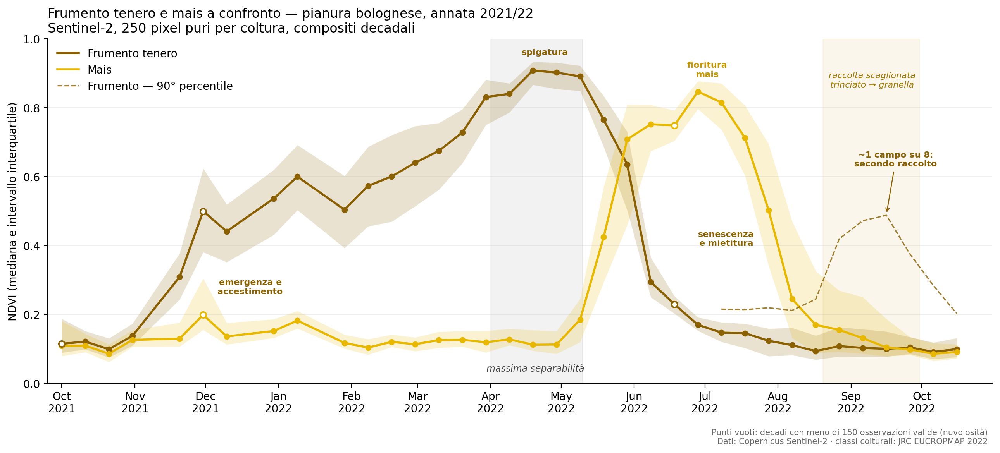
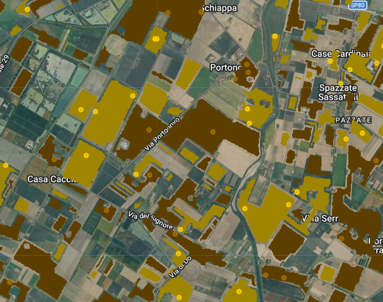
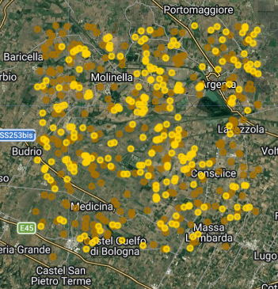
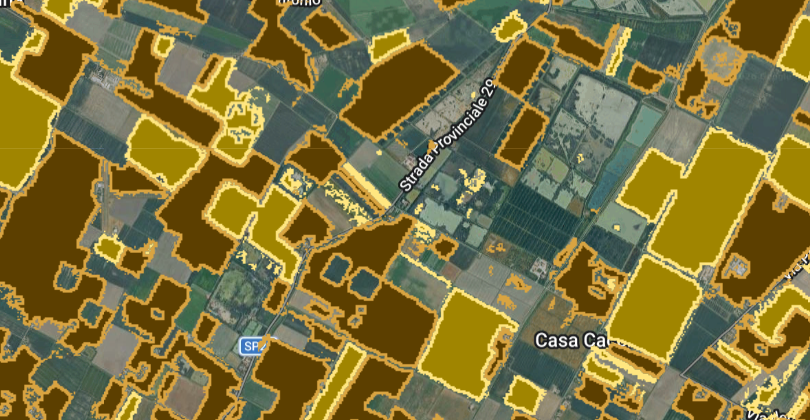

# Frumento tenero e mais visti da satellite — pianura bolognese, 2021/22

Curve stagionali di NDVI delle due principali colture erbacee della bassa
bolognese, ricostruite da Sentinel-2 su un'annata agraria completa di 395 giorni, dal 1° ottobre 2021 al 31 ottobre 2022.

## In breve

Quattro risultati:

1. **La finestra di massima separabilità è la seconda metà di aprile**, con una
   distanza fra le mediane di 0,79 punti di NDVI. In quel periodo una singola
   immagine basta a distinguere le due colture; a fine settembre la distanza
   scende sotto 0,01 e nessuna immagine singola è informativa.
2. **La senescenza del frumento è datata fra fine maggio e metà giugno 2022**,
   con un calo della mediana da 0,89 a 0,23 in tre decadi.
3. **Circa un campo di frumento su otto mostra una ripresa vegetativa in
   settembre** (10-14% dei punti sopra NDVI 0,40), compatibile con un secondo
   raccolto o una coltura di copertura. La mediana non lo rileva, ma emerge 
   dal 90° percentile.
4. **La banda interquartile del mais in fase di raccolta (agosto-settembre) è più ampia di
   quella del frumento alla mietitura**,
  questa ampiezza è dovuta al differente periodo di mietitura tra mais da granella e da trinciato
  e da diverse classi di precocità. 

## Dati

| Fonte | Uso | Licenza |
|---|---|---|
| [JRC EUCROPMAP 2022](https://developers.google.com/earth-engine/datasets/catalog/JRC_D5_EUCROPMAP_V1) | identificazione delle colture (classi 211 e 216) | CC-BY-4.0 |
| Copernicus Sentinel-2 L2A | riflettanza, calcolo NDVI | Copernicus |
| Google Cloud Score+ | mascheratura nuvole e ombre | — |

Area di studio: rettangolo di circa 80.000 ha fra Medicina e Molinella
(11,55-11,90 E; 44,42-44,68 N). Periodo: 1 ottobre 2021 - 31 ottobre 2022,
per coprire un'annata agraria completa.

## Metodo

1. **Selezione** dei pixel delle classi 211 (frumento tenero) e 216 (mais) da
   EUCROPMAP 2022: 25.000 ha e 12.000 ha rispettivamente.
2. **Erosione morfologica 5×5**: si conserva un pixel solo se tutti i 24
   vicini appartengono alla stessa classe. Elimina i pixel misti di bordo
   campo e gran parte degli errori isolati di classificazione. Si ottiene una superficie
   residua: 18.000 ha e 8.000 ha.
   
3. **Campionamento stratificato** di 250 punti per classe (seed = 42), fissi
   per tutta la serie temporale ed esportati come asset immutabile.
4. **Serie Sentinel-2**: 155 scene, NDVI = (B8−B4)/(B8+B4), mascheratura con
   Cloud Score+ (`cs_cdf` ≥ 0,60), compositi decadali per mediana. 39 decadi coprono i 395 giorni del periodo.
5. **Filtri di qualità**: a livello di osservazione, la soglia
   Cloud Score+; a livello di decade, esclusione sotto 30 punti validi su 250
   e marcatura (con punto vuoto nel grafico) sotto 150.
6. **Aggregazione** per coltura e decade: mediana, quartili e 90° percentile su frumento.

   ## nota sul processo
   Gli script su google engine e notebook sono satati scritti con l'aiuto di un agente AI, procedimento metodologico
   validazione dei dati e interpretazione agrnonomiche sono mie.

## Limiti

- **Un solo anno, e di siccità.** Il 2022 è stato segnato da una
  siccità eccezionale in pianura padana. Le curve non rappresentano un
  comportamento medio pluriennale.
- **Distorsione verso gli appezzamenti grandi.** L'erosione 5×5 scarta
  interamente i campi stretti o irregolari. Il campione descrive la
  cerealicoltura di pianura su campi medio-grandi. Lo stesso metodo in collina
  renderebbe molto peggio.
- **Accuratezza della mappa colturale.** EUCROPMAP ha un'accuratezza non
  unitaria; l'erosione riduce ma non annulla gli errori di classificazione.
  Nessuna validazione a terra è stata effettuata.
- **Lacune invernali.** Delle 39 decadi generate, una non ha prodotto alcuna
  osservazione valida e due sono state escluse per numerosità insufficiente
  (n < 30): il grafico ne riporta 36. Nove decadi hanno meno di 150
  osservazioni valide su 250 e sono marcate con punto vuoto; si concentrano
  fra novembre e gennaio, per effetto della nebbia padana.
- **L'NDVI data la senescenza, non la raccolta.** Il calo precede il passaggio
  della mietitrebbia di alcuni giorni.
- **La natura del secondo raccolto non è determinata.** Le date sono
  compatibili con soia o sorgo di secondo raccolto, oppure con una cover crop:
  la distinzione richiederebbe un sopralluogo o un classificatore dedicato.
  **precisione mappa UCROPMAP** la precisione dichiarata per le culture principali
  è del 79.3%.

## Riprodurre

| File | Dove si esegue |
|---|---|
| [`google engin code`](gee/gee_code.js) | Code Editor di Google Earth Engine |
| [`notebook calcoli`](notebook/Untitled1.ipynb) | Google Colab |
| [`Dati/ndvi_frumento_mais_2022.csv`](Dati/ndvi_frumento_mais_2022.csv) | output dello script GEE, input del notebook |

## Licenza e attribuzione

Codice distribuito con licenza MIT. Figure ed elaborazioni con licenza
CC-BY-4.0.

Questo lavoro utilizza dati EUCROPMAP del Joint Research Centre della
Commissione europea (CC-BY-4.0) e dati Copernicus Sentinel-2 modificati,
elaborati su Google Earth Engine.

> d'Andrimont, R., Verhegghen, A., Lemoine, G., Kempeneers, P., Meroni, M. &
> Van der Velde, M. (2021). *From parcel to continental scale — A first
> European crop type map based on Sentinel-1 and LUCAS Copernicus in-situ
> observations.* Remote Sensing of Environment, 266, 112708.
> [doi:10.1016/j.rse.2021.112708](https://doi.org/10.1016/j.rse.2021.112708)
> & d'Andrimont, R. (2024). *European Union crop map 2022: Earth observation's
> 10-meter dive into Europe's crop tapestry.* Scientific Data, 11, 1048.
> [doi:10.1038/s41597-024-03884-y](https://doi.org/10.1038/s41597-024-03884-y)

---

**Leonardo Bonfiglioli** — Laurea magistrale in Precise and Sustainable
Agriculture, Università di Bologna
[LinkedIn](https://www.linkedin.com/in/leonardo-bonfiglioli-516317371) · ottobre 2026
